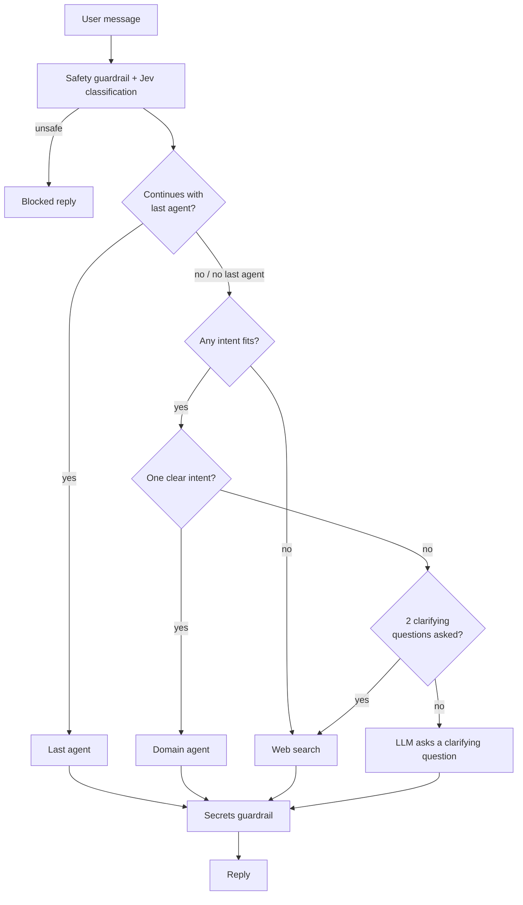
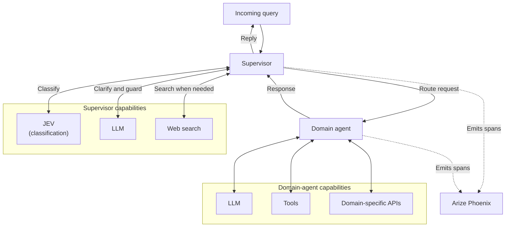

# Multi-Agent Setup

A demo of a multi-agent chatbot with a single supervisor and specialized domain agents. The supervisor is the user's only entry point: it classifies and routes requests, monitors the conversation, and can step in when needed. Domain agents provide domain-specific knowledge and perform actions within their areas. Arize Phoenix provides observability for agent reasoning and tool calls: every agent, including the supervisor and each domain agent, emits spans to Phoenix. The supervisor starts the trace, and participating domain agents add their spans so the complete request is visible together as a trace in Phoenix.

## Agent Responsibilities

### Supervisor

- Classifies requests using JEV (a system-one model), with each domain agent's description as an intent.
- Keeps a conversation with the agent that answered last when the user follows up (for example "yes" to that agent's question).
- Asks clarifying questions with a plain LLM completion call when two intents are close.
- Routes requests to the appropriate domain agent.
- Applies generic input and output guardrails. The safety guardrail runs on the LLM or on Jev (`GUARDRAIL_PROVIDER`); with Jev, each kind of unsafe message (jailbreak, prompt injection, harmful request) is a separate question in `agents/supervisor/safety.py`, and any one above `UNSAFE_THRESHOLD` (0.7, in `common/config.py`) blocks the message.
- Falls back to web search when no intent fits, or when the request is still unclear after two clarifying questions. In an organization, this could be replaced with organization-specific RAG.

### Domain Agents

Each domain agent should:

- Answer questions within its domain.
- Perform actions on the user's behalf when supported.
- Apply domain-specific input and output guardrails.
- Follow the policies defined in code.
- Reply with `OUT_OF_SCOPE` when a request falls outside its domain, so the supervisor can handle it.

## Installation

### Prerequisites

- Docker
- Access to JEV (a TypeSafe API key)
- Access to an LLM compatible with the OpenAI Agents SDK

### Configure

Copy `.env.template` to `.env` and fill in:

| Variable | Purpose |
|---|---|
| `JEV_API_KEY` | TypeSafe API key for Jev intent classification |
| `LLM_API_KEY` | API key for the LLM used by all agents |
| `AI_MODEL` | Model name, e.g. `gpt-5.6` |
| `LLM_BASE_URL` | Optional; set for an OpenAI-compatible provider, leave empty for OpenAI |
| `GUARDRAIL_PROVIDER` | Optional; `llm` (default) runs the supervisor's safety guardrail on the LLM, `jev` runs it on Jev |

Optionally set `PHOENIX_PUBLIC_URL` for the supervisor if Phoenix is not served at `http://localhost:6006`.

All other settings (domain agent URLs and descriptions, routing and guardrail thresholds, timeouts, Redis TTL, the filesystem workspace) live in `common/config.py`.

### Run locally

1. Make sure Docker is running.
2. Run `docker compose up --build`. Run it again after changing code to rebuild.
3. Once the containers are running, open [http://localhost:3000](http://localhost:3000) to chat with the supervisor.
4. Click **To Phoenix** in the chat's side panel to open the conversation's session in Phoenix, or browse [http://localhost:6006](http://localhost:6006) directly.
5. Stop everything with `docker compose down`.

## Architecture

### Components

This monorepo contains these components:

- **Supervisor agent** — Python (FastAPI)
- **Domain agents** — Python (FastAPI + OpenAI Agents SDK)
- **Common logic** — shared Python code used by agents
- **Frontend** — a single-page Vue.js chat window, served by nginx
- **Arize Phoenix** — observability for spans emitted by every agent
- **Redis** — short-term memory: conversation history, the active agent and the clarification count per conversation

### Repository structure

```text
/
├── agents/
│   ├── Dockerfile          # Shared image; pick the agent with the AGENT build arg
│   ├── supervisor/         # Python project; deployable
│   │   ├── main.py         # API, guardrails, clarification, web search, Phoenix link
│   │   ├── routing.py      # Jev questions and the routing decision table
│   │   └── safety.py       # Jev safety-guardrail questions
│   ├── domain_filesystem/  # Python project; deployable (lists, reads, writes and deletes files)
│   └── domain_animals/     # Python project; deployable (animal facts)
├── common/                 # Shared Python code (config, contract, guardrails, runtime, tracing)
├── frontend/               # Vue.js chat window
├── scripts/                # Shell scripts for setting up domain agents
└── docker-compose.yaml     # Local services and deployables + arize phoenix image
```

### Supervisor API

| Endpoint | Purpose |
|---|---|
| `POST /chat` | `{ "conversation_id": "<uuid>", "message": "..." }` → `{ "reply": "...", "approval": null }`; answer a pending approval with `{ "conversation_id": "<uuid>", "approved": true }` |
| `GET /conversations/{conversation_id}/phoenix` | Redirects to the conversation's session in Phoenix (or the project's sessions list before the first message) |

The frontend generates `conversation_id` (a random UUID) when a conversation starts; **New conversation** in the side panel starts a fresh one.

### Supervisor routing

Every user message is classified by Jev in one request, with the whole conversation as state. Question wording lives in `agents/supervisor/routing.py`; the thresholds live in `common/config.py`.

- **intent**: which intent the user wants right now. Each domain agent's description (`DOMAIN_AGENTS` in `common/config.py`) is an intent; add custom intents to `CUSTOM_INTENTS` in `agents/supervisor/main.py`, each with its own handler.
- **fits_any**: whether any intent covers the request at all (a choice always picks something, so this catches requests none of them handle).
- **continues_active**: asked only when an agent answered the previous turn; whether the user is continuing that exchange.

Code then decides:

| Condition | Action |
|---|---|
| `continues_active` > 0.7 | Route back to the agent that answered last |
| `fits_any` < 0.4 | Web search |
| Top intent > 0.7 and no other intent within 0.2 | Route to that domain agent |
| Otherwise, fewer than 2 clarifying questions asked | Ask a clarifying question between the close intents |
| Otherwise | Web search |

If a domain agent replies `OUT_OF_SCOPE`, the supervisor falls back to the normal classification (when the turn was routed as a continuation) or to web search.



### Supervisor ↔ domain agent contract

Every domain agent exposes `POST /chat` (see `common/contract.py`):

```json
// request: the conversation so far
{ "messages": [{ "role": "user", "content": "What do red foxes eat?" }] }
// response: the messages the agent added
{ "messages": [{ "role": "assistant", "content": "Red foxes are omnivores..." }] }
```

A domain agent replies with exactly `OUT_OF_SCOPE` when a request falls outside its domain.

**Human in the loop.** A tool declared with `@function_tool(needs_approval=True)` (for example the filesystem agent's `delete_file`) pauses the run. The agent keeps the paused run in memory and responds with `"approval": { "id", "tool", "arguments" }`. The supervisor stores it per conversation and the frontend shows **Approve** / **Reject**. The decision goes back to the same agent as `"approval": { "id", "approved": true }` in the request, and the agent resumes its run. Sending a normal message instead drops the pending approval. The supervisor passes W3C `traceparent` and `baggage` headers (see `common/tracing.py`), so the domain agent's spans join the same Phoenix trace and carry the same `session.id`.

### Tracing

Spans go to the `multi-agent-setup` project in Phoenix.

- **Sessions** groups a whole conversation: every span carries `session.id` = `conversation_id`. Each turn shows the user's message and the final reply.
- **Traces** has one trace per user message, rooted at the `supervisor` span and spanning any domain agent it calls:
  - `guardrail: safety` (with `guardrail.provider`; with Jev also `guardrail.score` (the highest check probability), `guardrail.top_check`, `guardrail.threshold` and each check's probability) and `guardrail: secrets`
  - `jev: classify intent`, with each intent's probability, `fits_any`, `continues_active`, model and tokens
  - `llm: clarify`, with the prompt messages and tokens
  - `call <name> agent`, and inside the domain agent its LLM calls, tool calls and guardrails
  - the web search agent
- The supervisor span records the routing outcome: `supervisor.action`, `supervisor.intent`, `supervisor.sticky`, `supervisor.active_intent` and `supervisor.clarifications_asked`.

FastAPI's built-in request tracing is turned off (`telemetry={"tracing": False}`); its HTTP spans would otherwise become the trace root and hide each turn's input and output in Phoenix sessions.

### Flow diagram



## Requirements and Constraints

- A single supervisor is responsible for orchestration between agents.
- Direct agent-to-agent communication is not allowed; requests between domain agents must go through the supervisor.
- Each agent is independently deployable and exposes its service over HTTPS.
- Each agent uses its own identity and cannot call APIs intended for another agent.
- The supervisor must always observe the conversation and be able to intervene.
- All domain agents follow the same contract with the supervisor.
- The agent framework must be the OpenAI Agents SDK.
