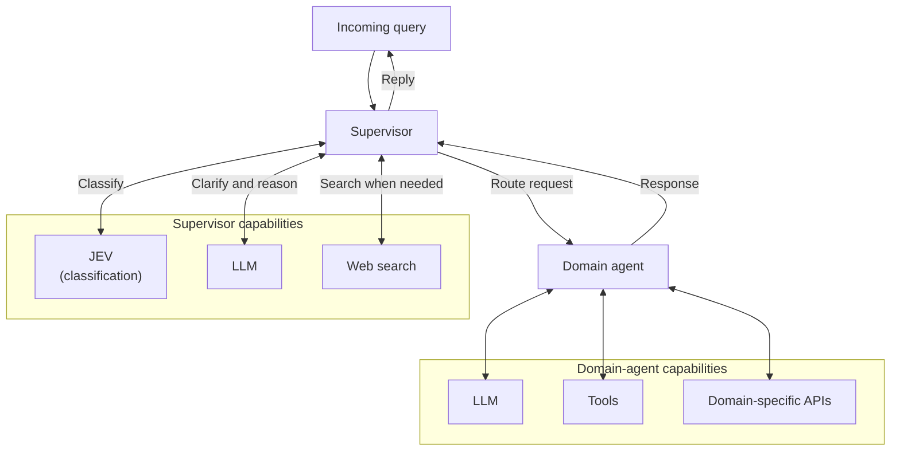

# Multi-Agent Setup

A demo of a multi-agent chatbot with a single supervisor and specialized domain agents. The supervisor is the user's only entry point: it classifies and routes requests, monitors the conversation, and can step in when needed. Domain agents provide domain-specific knowledge and perform actions within their areas.

## Agent Responsibilities

### Supervisor

- Classifies requests using JEV (a system-one model).
- Asks clarifying questions with an LLM when the request is unclear, using domain-agent descriptions as context.
- Routes requests to the appropriate domain agent.
- Applies generic input and output guardrails.
- Falls back to web search if the request remains unclear after two clarification attempts. In an organization, this could be replaced with organization-specific RAG.

### Domain Agents

Each domain agent should:

- Answer questions within its domain.
- Perform actions on the user's behalf when supported.
- Apply domain-specific input and output guardrails.
- Follow the policies defined in code.
- Ask the supervisor to route a request to another domain agent when it falls outside its scope.

## Installation

### Prerequisites

- Docker
- Access to JEV
- Access to an LLM compatible with the OpenAI Agents SDK

### Run locally

1. Make sure Docker is running.
2. Run `make run`.
3. Once the containers are running, open [http://localhost:3000](http://localhost:3000) to chat with the supervisor.

## Architecture

### Components

This monorepo contains four component types:

- **Supervisor agent** — Python
- **Domain agents** — Python
- **Common logic** — shared Python code used by agents
- **Frontend** — Vue.js

### Repository structure

```text
/
├── agents/
│   ├── supervisor/       # Python project; deployable
│   ├── domain_agent1/    # Python project; deployable
│   └── domain_agent2/    # Python project; deployable
├── common/               # Shared Python code
├── frontend/             # Vue.js application
├── scripts/              # Shell scripts for setting up domain agents
├── Makefile              # Commands for running the system locally
└── docker-compose.yaml   # Local services and deployables
```

### Flow diagram



## Requirements and Constraints

- A single supervisor is responsible for orchestration between agents.
- Direct agent-to-agent communication is not allowed; requests between domain agents must go through the supervisor.
- Each agent is independently deployable and exposes its service over HTTPS.
- Each agent uses its own identity and cannot call APIs intended for another agent.
- The supervisor must always observe the conversation and be able to intervene.
- All domain agents follow the same contract with the supervisor.
- The agent framework must be the OpenAI Agents SDK.
